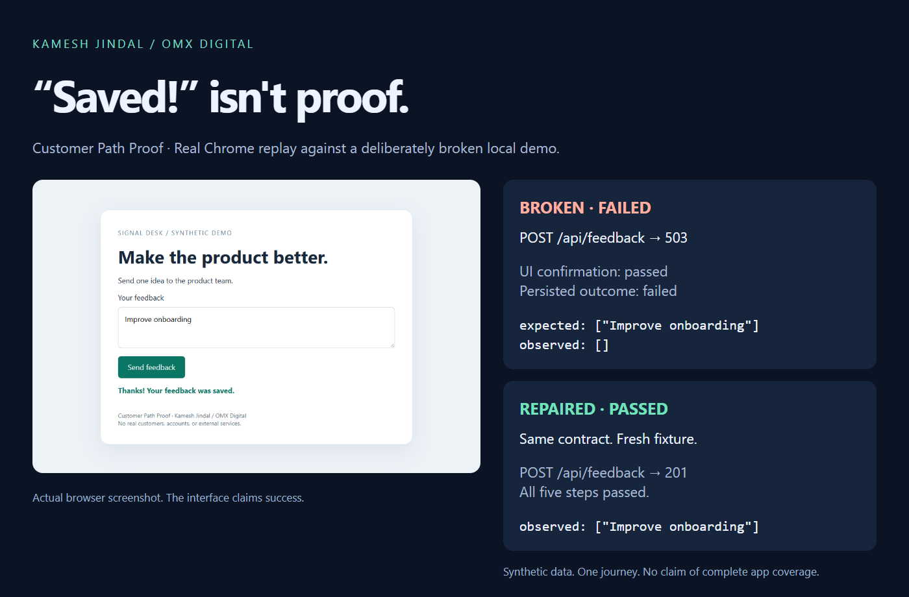

# Customer Path Proof

**The screen says “Saved!” Did the application actually save it?**

Customer Path Proof pairs a customer journey with an independent readback of its result. A tiny Playwright runner collects screenshots, failed network responses, console errors, and the first failed outcome. A Claude skill helps turn that evidence into a focused diagnosis and a clean replay after a fix.

By **Kamesh Jindal / OMX Digital**. Early, focused MVP; no adoption or comprehensive coverage claims.



## Run the proof in two minutes

Requires Node.js 20+ and a supported Playwright browser.

```sh
npm install
npx playwright install chromium
npm run demo
```

Open the printed `artifacts/demo-.../index.html`. The demo starts its own loopback servers and closes them afterward. No login, API key, cloud service, or real customer data is used.

| Same contract | Broken demo | Repaired demo |
| --- | --- | --- |
| Send synthetic feedback | POST returns 503 | POST returns 201 |
| Visible confirmation | “Your feedback was saved.” | “Your feedback was saved.” |
| Independent persisted readback | Empty list → **failed** | Expected feedback → **passed** |

The broken demo intentionally ignores the POST failure. A screenshot-only check would accept the success message. This contract catches the missing result.

To use an already installed Chrome instead of downloading Chromium, set `CPP_BROWSER_CHANNEL=chrome` for the demo (PowerShell: `$env:CPP_BROWSER_CHANNEL='chrome'`). The CLI equivalent is `--channel chrome`.

## Test your authorized local or staging app

Copy `demo/journey.json`; replace selectors and the persisted outcome endpoint with your app's own test fixture. Then:

```sh
node scripts/run.cjs --contract journey.json --origin http://127.0.0.1:3000 --out artifacts/my-run --allow-write POST:/api/feedback
```

The output directory must not already exist. Each run preserves its own evidence. Omit `--allow-write` for read-only journeys; repeat it for additional exact method/path pairs. Only the given origin is allowed. Query strings do not change write-path matching. Explicit origin and write flags express scope, not proof of ownership: run only on systems you are authorized to test.

Contract version 1 supports:

| Action | Required fields | What it checks |
| --- | --- | --- |
| `open` | `path` | Same-origin navigation succeeds |
| `fill` | `selector`, `value` | Fill an input using Playwright |
| `click` | `selector` | Click an element |
| `visible` | `selector`, `value` | Exact visible text |
| `saved` | `path`, `field`, `equals` | GET returns 200 and a top-level JSON field deeply equals the expected value |

Every step needs a unique `id`. At least one `saved` check is required. Readback is immediate: this MVP intentionally does not guess an eventual-consistency window. Use deterministic fixtures and endpoints that expose the relevant saved result. There is no arbitrary JavaScript step, imported browser profile, login management, account creation, or payment workflow.

Exit codes: `0` passed, `1` check failed, `2` blocked/incomplete/invalid invocation. Inspect `report.json` for the exact status, first divergence, and unexecuted steps. `report.html` is a standalone visual report linked to PNG evidence. Console and HTTP errors are diagnostic context, not automatic assertion failures.

## Use with Claude Code

Place this repository's contents in `.claude/skills/customer-path-proof/` in your project and install dependencies in that directory. Ask Claude: “Use customer-path-proof to verify that submitting synthetic feedback on my local app really persists it. The authorized write is POST /api/feedback.” The runner also works without Claude.

## Scope and limits

- Designed for trusted local/staging applications and synthetic data. Browser routing reduces accidental scope expansion; it is not a security sandbox. Even GET requests can mutate poorly designed endpoints.
- Cross-origin HTTP requests, unapproved write methods, all HTTP redirects (including same-origin redirects), WebSockets, service workers, and popups are blocked. Use final URLs directly. A dependency blocked by scope yields a blocked result, not an app defect. Saved-state readback uses a separate HTTP client that application JavaScript cannot mock.
- No production testing, auth/CAPTCHA bypass, credential scraping, or automatic external publishing. No claim to discover all bugs.
- Query strings, headers, and response bodies are omitted from network event summaries. Screenshots, console text, expected values, and exception messages can still contain secrets or personal data. Review artifacts before sharing.
- UI plus one readback is stronger than a toast alone, but only as meaningful as the endpoint and fixture you choose. It does not prove storage durability after a restart or correctness of other customer paths.

## Verification

```sh
npm test
```

Unit tests run by default. For actual browser integration, set `CPP_BROWSER_TESTS=1` and run `npm test` (PowerShell: `$env:CPP_BROWSER_TESTS='1'`). These tests exercise the broken write, repaired write, denied write, PNG evidence, and protection against overwriting prior evidence. Browser integration is skipped unless explicitly enabled; `npm run demo` always uses a real browser.

Playwright already provides browser automation and traces; [Checkly](https://www.checklyhq.com/docs/detect/synthetic-monitoring/playwright-checks/overview/) provides production monitoring, and [Browser Use](https://github.com/browser-use/browser-use) provides AI browser agents. This project focuses on small, reviewable customer-outcome contracts and the gap between an apparent UI success and independently observable saved state. It builds on [Playwright](https://playwright.dev/docs/intro), rather than replacing it.
